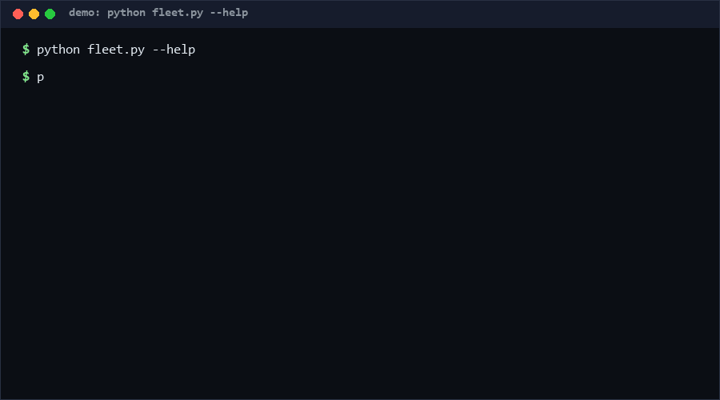

# persistent-bot-fleet

Run a team of long-lived bots on a single JSON file: spawn once, message each other forever, survive restarts. Bot-to-bot messages are the cheapest inter-agent protocol there is — no broker, no framework, no ports. If you are orchestrating multiple agent roles and your "topology" is really just "who talks to whom," this is enough; if you need delivery guarantees, retries, or cross-machine transport, it is not.

<p align="center"></p>

## Problem

Most bots are single-session, single-role: the process ends, memory ends. The interesting pattern from long-lived harness bots is different — bots as **persistent processes with roles**, a shared group as the bus, and direct bot-to-bot messaging as the whole coordination protocol. Agent-team topology does not need an orchestration framework; it needs an inbox.

The overlooked angle: an IM-style message list *is* a message bus. Sequenced, inspectable, restartable. Adding Redis to get there is a dependency you don't need at fleet-of-5 scale.

## How it works

- `Fleet(state_path)` — loads existing state or starts empty.
- `spawn(name, role)` / `send(src, dst, text)` / `broadcast(src, text)` — the entire API. Messages are sequenced (`seq`), timestamped, and routed to per-bot inboxes; `drain(name)` reads-and-clears, `inbox(name)` peeks.
- Persistence: the whole state is one JSON document protected by a SHA-256 checksum over its canonical body. **Any tampering or truncation is detected on load and refuses to start** (fail-closed, not fail-silent).
- Writes are atomic (temp file + `os.replace`), so a crash mid-save never leaves a torn state file.
- Guards: no self-messages, no empty text, 1 MB message cap, fleet-size cap, duplicate-name rejection.

Quickstart (~5 min):

```bash
# 1. Self-test (~5 s, 17 cases)
python self_test.py

# 2. Live demo (~30 s)
python fleet.py --state demo.json spawn lead --role coordinator
python fleet.py --state demo.json spawn scout
python fleet.py --state demo.json send lead scout "recon the east wing"
python fleet.py --state demo.json inbox scout
# [1] lead -> scout: recon the east wing
python fleet.py --state demo.json broadcast lead "standby"
python fleet.py --state demo.json list
```

## Why not X

| Alternative | Why not |
|---|---|
| Redis / RabbitMQ | Real transport with acks and fan-out — and a server to run, secure, and pay for. At small-fleet scale on one machine, a checksummed JSON file is strictly simpler. |
| Multi-agent frameworks (crew-style) | They bring role abstractions plus their own LLM-call orchestration. If you only need the messaging substrate, the framework is 99% overhead. |
| SQLite inbox | More robust at high write concurrency, but adds a query dialect and migration concerns for what is here ~100 lines of stdlib JSON. Reasonable upgrade path, not a starting point. |
| Plain shared log file | No per-bot routing, no corruption detection, torn writes on crash. This repo's checksum + atomic replace exist precisely to fix that. |

## Minimal Fallback

No this-repo? The pattern degrades gracefully:

- Same directory, same idea, zero code: one append-only `messages.jsonl` per bot, `tail -f` as the inbox. Lose checksums and atomicity; keep the topology.
- In Python stdlib, `collections.deque` per bot in a single process gives you the in-memory version in ten lines — use this repo when you need **restart survival**.

## Design Trade-offs

Priorities: **durability > integrity > simplicity > throughput.**

- Whole-file JSON state: trivially inspectable (`cat fleet.json`), but O(n) on save. Deliberate — fleets of ~5 bots with hundreds of queued messages, not firehoses.
- Checksum failure is a hard stop, not a best-effort recovery: silent state "repair" is how agent memory rots.
- Messages are removed on `drain`, not archived: keeps the file small; if you need history, copy before draining.

## Limits & Second-order Effects

- Single-process, single-machine. Two agents writing the same state file concurrently will corrupt it (checksum will catch it — by refusing to start).
- Second-order effect: because bot-to-bot messaging is so cheap, fleets tend to **accumulate chatty roles** that forward everything; message volume grows linearly with bot count squared in broadcast-heavy topologies. Budget message volume like you budget tokens.
- A fleet file that survives restarts becomes operational memory — teams start trusting it like a database. It is not one: no locking, no replication, no compaction.

## FAQ

**Is the state file safe against concurrent writers?**
No. One writer at a time, or split state files per process. The checksum detects concurrent-write damage; it cannot prevent it.

**When should you NOT use this tool?**
Cross-machine fleets, >~10 bots with heavy message volume, or anything needing delivery guarantees/retries — use a real broker. Also not for secret payloads: the state file is plaintext JSON.

**Why refuse self-messages?**
A bot journaling to itself is a different tool (a notebook, not a bus); allowing it blurs the protocol for zero benefit.

## Core Assumptions

1. Target scale is one machine, one writer process, ≤ ~10 bots — below the threshold where a broker pays for itself.
2. Plaintext state is acceptable (no secrets in message bodies), since agent payloads are prompts/results, not credentials.
3. Restart-survival matters more than write throughput for long-lived agent fleets.
4. `os.replace` atomicity holds on the target filesystem (true on NTFS/ext4/apfs for same-directory renames).

Confidence: **High** that checksummed single-file state is sufficient below ~10 bots on one machine (mechanism is fully covered by 17/17 self-tests including tamper and garbage-file cases — reproduce with `python self_test.py`). Confidence: **Medium** that bot-to-bot messaging displaces heavier orchestration for small teams — plausible from the topology argument, no external fleet benchmarks yet [estimated].

Fleet-size/message-cap numbers are design constants (see `fleet.py`), current **as of 2026-10-11**.

Source inspiration (structural restatement only): https://github.com/FeiZhuLulu/DeepSeek-Bot — persistent harness bots with inter-bot messaging.

License: MIT. Contact: hcac4735@agent.qq.com
